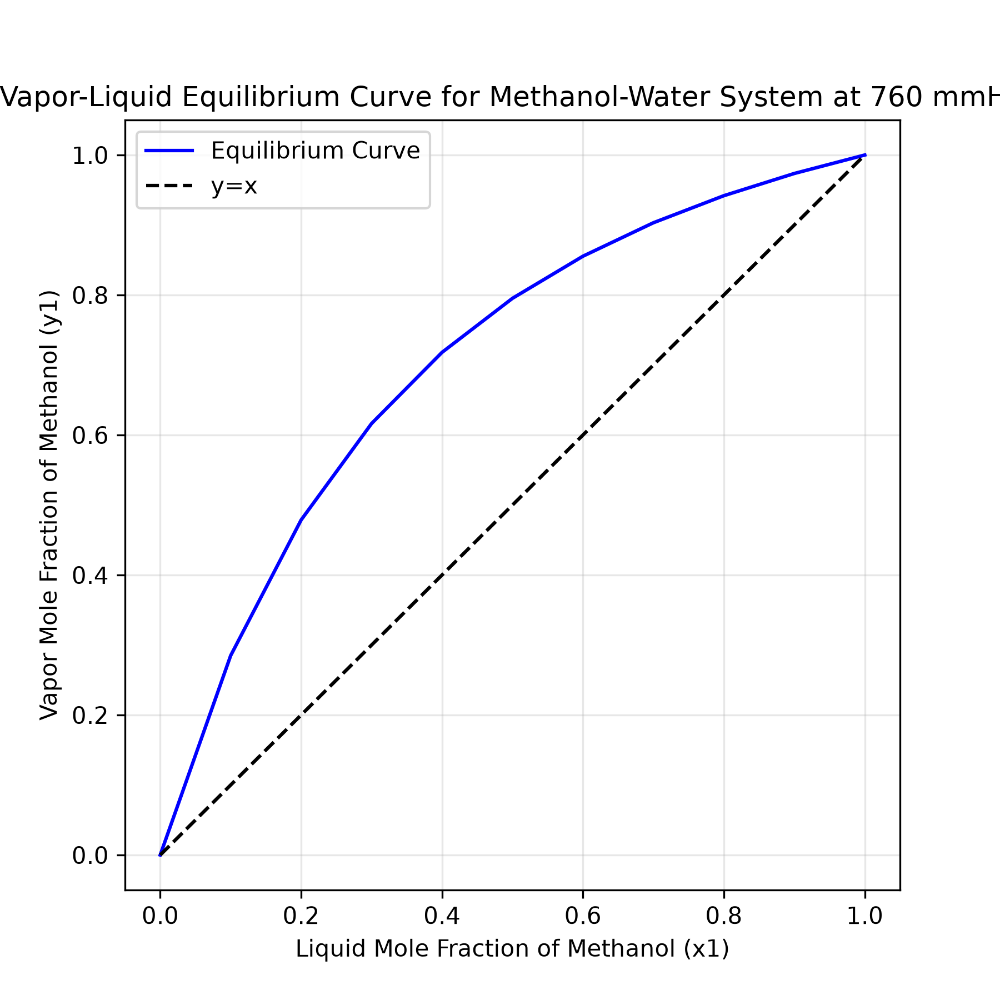
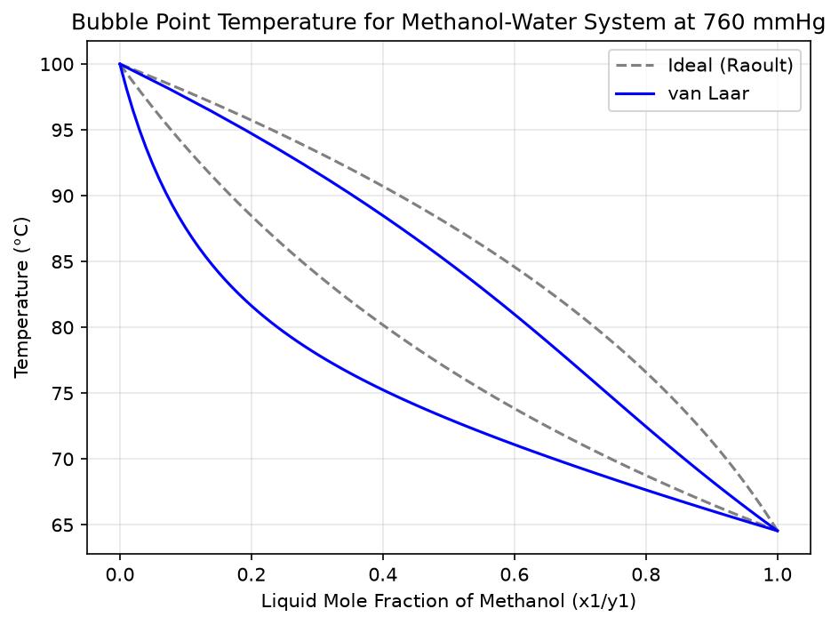

# Vapor–Liquid Equilibrium: Methanol–Water

Calculates bubble point temperatures and equilibrium vapor compositions for a
binary methanol–water mixture, under two thermodynamic models: ideal behaviour
(Raoult's law) and non-ideal behaviour (van Laar activity coefficients). The
difference between them is the point of the project.

## The problem

For a binary mixture at fixed total pressure `P`, the bubble point temperature
is the temperature at which the partial pressures of both components first sum
to `P`:

```
x₁·γ₁·P₁°(T) + x₂·γ₂·P₂°(T) - P = 0
```

This equation is implicit in `T` and has no closed-form solution: the unknown
appears inside two separate exponential terms, one per component, and cannot be
isolated algebraically.

It is solved numerically with Brent's method. The search interval is bounded by
the normal boiling points of the two pure components, widened by 20 °C — the
margin matters, because with activity coefficients a mixture can boil *below*
both pure boiling points, which is what an azeotrope is.

Once `T` is known, the vapor composition follows directly:

```
y₁ = x₁·γ₁·P₁°(T) / P
```

Setting γ₁ = γ₂ = 1 recovers Raoult's law, so both models run through the same
solver and the same code path.

## Why ideal isn't enough

Methanol and water both hydrogen-bond, but not equally well with each other as
with themselves. Mixing them is energetically unfavourable relative to the ideal case, so molecules escape to the vapor more readily than Raoult's law predicts.
This is a **positive deviation**, and it means γ > 1 for both components.

The van Laar model captures this with two parameters:

```
ln γ₁ = A₁₂ / [1 + (A₁₂·x₁)/(A₂₁·x₂)]²
ln γ₂ = A₂₁ / [1 + (A₂₁·x₂)/(A₁₂·x₁)]²
```

At the composition extremes the coefficients reach their infinite-dilution
limits, γ₁∞ = exp(A₁₂) and γ₂∞ = exp(A₂₁).

## Results

At 760 mmHg with an equimolar liquid (x₁ = 0.5):

| | T (°C) | y₁ |
|---|---:|---:|
| Raoult (ideal) | 76.82 | 0.7953 |
| van Laar | 73.03 | 0.7866 |
| Experimental (literature) | — | ≈0.78 |

The non-ideal model boils **3.8 °C lower** and predicts a vapor composition
closer to experiment. At 1500 mmHg and x₁ = 0.32 the gap is larger still:
102.86 °C ideal against 96.82 °C with activity coefficients.

A detail worth noting: Δy₁ is slightly **negative**, even though both activity
coefficients exceed 1. At x₁ = 0.5 the coefficients are γ₁ = 1.137 and
γ₂ = 1.222 — water is the more strongly enhanced of the two at this
composition, because γ₁ falls from its maximum at infinite dilution while γ₂
rises toward its own. Water's partial pressure is boosted proportionally more,
so methanol's share of the vapor drops marginally even as the total pressure
rises and the mixture boils earlier.

Both models converge at the pure-component limits, as they must: at x₁ = 0 and
x₁ = 1 there is only one species present, γ = 1 by definition, and the two
curves meet.





## Assumptions and limitations

**Ideal vapor phase.** Both models treat the vapor as an ideal gas. At
atmospheric pressure this is a reasonable approximation; at elevated pressures
it is not, and a fugacity coefficient would be needed.

**Temperature-independent van Laar parameters.** In the two-parameter form used
here, A₁₂ and A₂₁ are constants. They are in reality weakly temperature
dependent. Over the 64–100 °C range of this system the error is tolerable, but
the model should not be used far outside it.

**Antoine validity range.** The Antoine coefficients are valid over a limited
temperature range. The program will happily return a bubble point at 15000 mmHg,
but that result should not be trusted.

**Fitted, not primary, parameters.** The van Laar constants below are a
least-squares fit published in a secondary source, not primary tabulated data
from a reference collection such as DECHEMA. Comparison against a full experimental x–y
dataset across the composition range is the natural next step.

## Usage

```bash
pip install -r requirements.txt
python vle.py
```

The program asks for a liquid composition and a pressure, prints both models
side by side with their difference, and writes the x–y and T–x–y diagrams as
PNG files.

## Data

**Antoine equation**, `log₁₀(P°) = A - B/(T + C)`, with `P°` in mmHg and `T` in °C:

| Component | A | B | C |
|-----------|---------|----------|---------|
| Methanol  | 8.08097 | 1582.271 | 239.726 |
| Water     | 8.07131 | 1730.630 | 233.426 |

*Source: I got the constants from ClaudeAI*

**van Laar parameters** for methanol(1)–water(2) at 101.325 kPa:

```
A₁₂ = 0.8407    A₂₁ = 0.5386
```

*Source: "Estimation of Activity Coefficients for Binary Mixture VLE Data using
MATLAB", IARJSET (2016), Table 2. These are least-squares fitted values, not
primary tabulated data.*

Please let me know about any mistake i made, or about any way to improve the program!